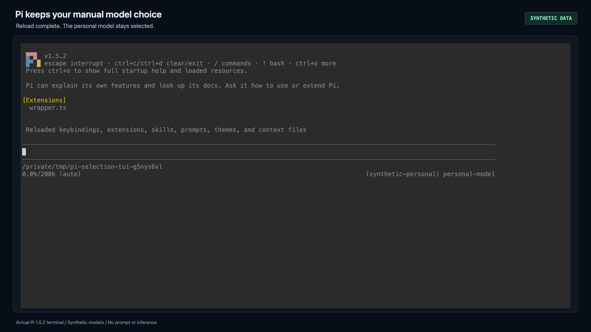

# agent-spells

Coding agent extensions, general spells, and small workflows I use to make the machine more useful.

Not a framework. Just a spellbook.

## What lives here

- `pi/extensions/answer/`
  - interactive answer flow for agent-generated questions
  - free-form, single-choice, multiple-choice, and ranking support
  - tests for normalization, extraction, and live integration
- `pi/extensions/provider-tool-profiles/`
  - provider-native core tool profiles for Claude, Codex/GPT, and Gemini
  - preserves unrelated Pi extension tools while swapping core file/shell tools
- `pi/extensions/vim-modal-editor/`
  - Vim-style modal editing for Pi's prompt box
  - wraps existing custom editors like floating-composer
- `pi/extensions/model-profiles/`
  - named model profiles and roles
  - preserves manual model choices across reload and resumed conversations

More spells over time.

## Pi model selection

Choose a concrete model with `/model`. The model-profiles extension keeps that
choice when you run `/reload` or resume the conversation. Use `/profile` to
select a profile again.

[](docs/videos/pi-manual-selection.mp4?raw=1)

The recording shows the actual Pi 1.5.2 terminal with synthetic work and personal
models. Pi has no network access, and no model request is submitted.
See the [profile setup and validation](pi/extensions/model-profiles/README.md).

## Philosophy

I like my agent tooling:
- composable
- inspectable
- easy to tweak
- useful fast
- no more elaborate than it needs to be

This repo is where I keep those enchantments.

## Install

```bash
bun install
```

## Common commands

Generate local client code:

```bash
bun run baml-generate
```

Run test suite:

```bash
bun run test
```

Run only the live integration test:

```bash
bun run test:integration
```

If local Ollama is available on `http://127.0.0.1:11434`, the live integration test runs automatically as part of `bun run test`. Otherwise it skips.

## Notes

This repo is consumed directly from my local agent setup. Example:

- `~/dev/agent-spells/pi/extensions/answer/index.ts`
